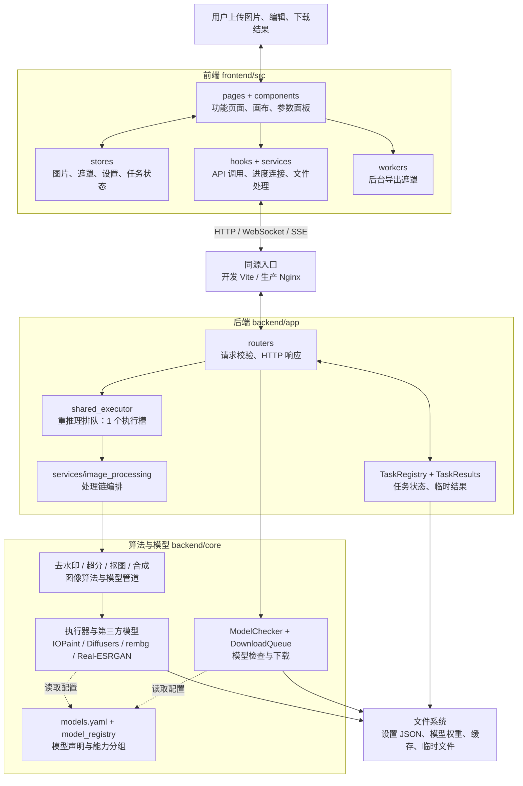
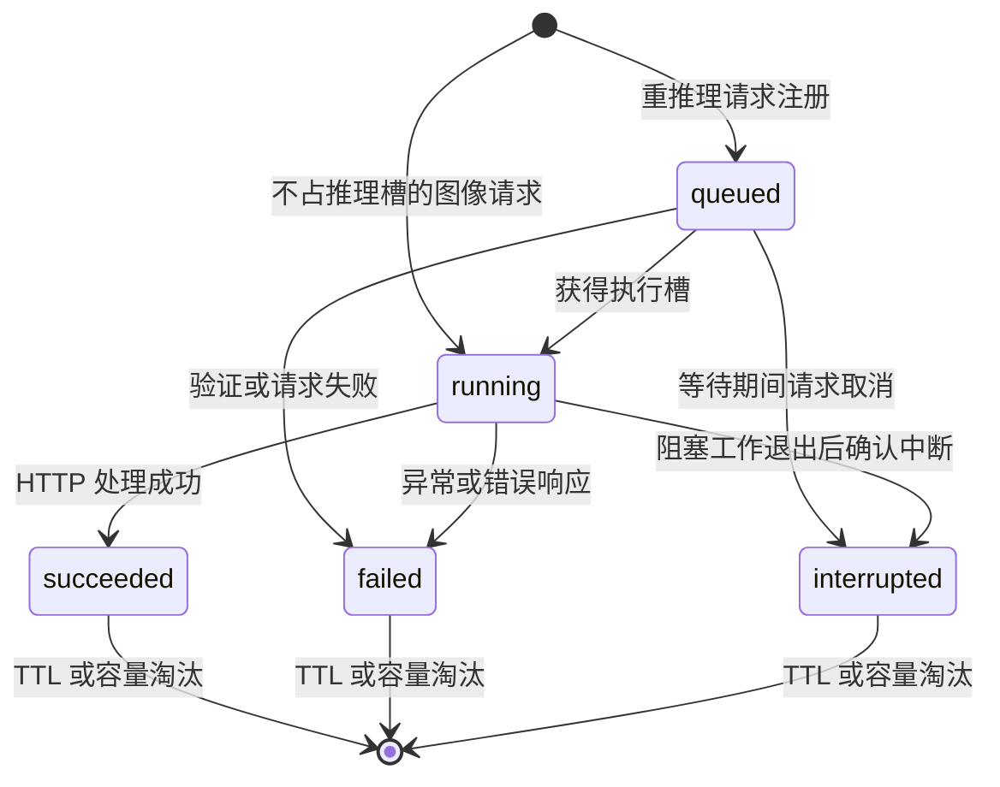
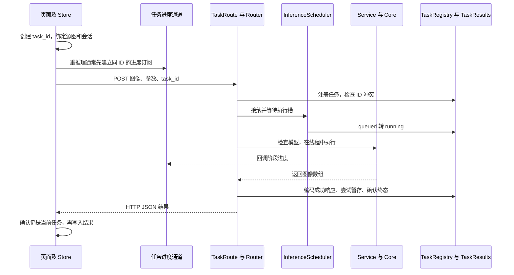

# HiImage 项目框架与系统架构

> 核对日期：2026-11-02。业务代码基线：`d0f0497`。本文根据当前仓库实现编写；注册表中的能力声明与已验证能力分开说明，不把待优化项当成已完成功能。

本文面向接手开发、测试与部署的维护者。建议先读第 1–10 节理解运行边界，再按第 11–19 节定位目录、业务调用链、完整接口、配置与扩展方式。

| 内容 | 章节 |
|---|---|
| 总体结构、前后端职责与通信 | 1–5 |
| 存储、部署、安全与任务生命周期 | 6–10 |
| 目录导航、技术栈与前端状态 | 11–13 |
| 图像处理链与模型扩展 | 14–15 |
| 完整 API 与配置 | 16–17 |
| 测试、已知限制与维护清单 | 18–19 |

系统不使用业务数据库、Redis 或独立消息中间件；任务状态、下载状态与模型实例主要位于当前进程内，配置及模型文件保存在文件系统。浏览器仅上传内容，不提交后端任意文件读写位置。

## 1. 架构概览

HiImage 是浏览器访问的单用户 AI 图像处理系统：

```text
Browser
  └─ HTTP / WebSocket / SSE
       └─ Nginx :80
            ├─ /、静态资源、SPA 回退 → React/Vite 构建产物
            └─ /api/* → FastAPI :8787
                           ├─ 路由与任务编排
                           ├─ 模型注册、下载与缓存
                           └─ CPU / CUDA / 本地 macOS MPS 推理
```

开发环境由 Vite 提供页面和 `/api` 代理；生产容器由 Nginx 提供同源入口。浏览器不直接访问容器内的后端端口。

### 分层结构图

下图展示主要调用和依赖关系；结果通过 HTTP 返回，进度通过 WebSocket、模型下载状态通过 SSE 返回。模型元数据、下载及部分 CPU 操作不经过重推理队列。



读图方式：前端负责交互和编辑状态；接口层负责校验和任务接纳；service 编排算法与模型；模型配置及运行产物由注册表和文件系统管理。主入口位于 `frontend/src/App.tsx` 和 `backend/app/main.py`，新功能通常从页面、API、service 一直贯通到 core。

## 2. 前端

`frontend/src/` 是 React 18 + TypeScript 应用，Vite 负责开发和构建：

- `pages/`：去水印、超分辨率、抠图、智能合成、模型、日志和设置。
- `components/`：画布、遮罩工具、批量队列、进度和通用 UI。
- `stores/`：Zustand 状态；编辑会话分别保存图片、结果、遮罩和参数，任务按 `task_id` 记录并绑定所属会话，超分单图与批量任务独立。
- `services/apiClient.ts`：统一生成同源 HTTP、WebSocket 和 SSE URL，并统一解析 API 响应与错误。
- `services/api/`：推理接口和模型/设备能力查询；React hook 只负责选择后端并缓存函数。
- `services/fileService.ts`：浏览器 File、Blob 和下载能力。
- `services/batchLimits.ts`：100 张、单文件 20 MB、输入总量 128 MB、累计结果 256 MB 与 ZIP 64 MB 限制。
- `services/imageDimensions.ts`：浏览器解码尺寸并按 `宽 × 高 × 倍率² × 4` 执行 256 MB 输出 RGBA 硬预算。

`AppRoutes.tsx` 按路由动态加载页面，`MainLayout` 只挂载当前页面；模型管理在设置页选择对应页签后才加载。页面切换释放画布、页面订阅和日志 WebSocket，并取消尚未完成的页面元数据请求。加载中与加载失败由 `PageBoundary` 提供状态和重试入口。

编辑会话与批量队列由 store 保留，已开始的推理和模型下载独立于页面继续执行。遮罩导出由 `services/maskExport.ts` 为每个任务创建 Worker，导出完成、失败或 60 秒超时后释放，页面卸载不会中断导出。设置草稿按后端地址保存在内存中，保留未保存输入和保存中状态；保存响应不会清除提交后新输入的内容。上述状态不支持浏览器刷新恢复。

任务开始时额外把至多 20 条任务 ID、工具会话、有效后端地址和开始时间写入当前标签页的 sessionStorage，不保存图像、遮罩、提示词或结果。成功、失败及被替代的任务都保留最近的元数据，用户移除提示或超过数量上限时删除，以支持完成后再刷新的结果取回。刷新后 `TaskRecoveryNotice` 按后端地址查询一次状态，可手动刷新或移除提示；可下载仍在服务端暂存的结果，不自动重新提交推理、覆盖编辑器或启动剩余批量队列。404 表示无法确认；成功但缓存不可用时明确提示无法取回。存储不可用不阻断处理。

前端不拥有后端进程生命周期，也不依赖操作系统文件路径。Web API 已无服务器路径读写模式：浏览器仅上传内容，选择的文件保存在内存中，结果由浏览器下载。批量处理按顺序发送，避免并发放大模型显存和页面内存。

## 3. Nginx 同源网关

`frontend/nginx.conf` 承担：

- 返回 `frontend/dist` 静态文件。
- `try_files $uri $uri/ /index.html` 支持浏览器未知路由回退。
- 把 `/api/` 代理到内部别名 `backend:8787`。
- 传递 `Upgrade` / `Connection` 以支持 WebSocket。
- 覆盖客户端传入的 `X-Forwarded-*`，再传递外部协议与保留端口的 host，让后端按浏览器看到的外部源校验 WebSocket Origin。
- 禁用 API 缓冲和缓存，保证 SSE/流式响应及时到达。
- 将请求体上限设为 80 MB；前端批量导入执行 20 MB 单文件限制，后端每张图片或遮罩执行 30 MB 压缩文件字节数限制，并在解码前检查 256 MB 输入 RGBA 预算。其他单图页面没有统一复用批量导入的 20 MB 入口校验。
- 为带哈希的静态资源设置长期不可变缓存。

## 4. FastAPI 后端

`backend/app/main.py` 注册系统、设置、模型、修复、超分、抠图、合成、日志、后处理和 WebSocket 路由。主要接口：

- `GET /api/health`：进程健康。
- `GET /api/ready`：配置、缓存、临时和输出目录可写性，以及用户配置设备的实际可用性。
- `GET /api/devices`：CPU、CUDA、MPS 能力。
- `GET /api/tasks/{task_id}`：当前进程内的任务状态、进度和 HTTP 终态，不返回图像结果。
- `GET /api/tasks/{task_id}/result`：取回仍在保留期内的成功响应 JSON，不重新执行推理。
- `GET/PUT /api/settings`：持久化设置。
- `POST /api/inpaint*`、`/api/upscale*`、`/api/cutout*`、`/api/synthesis/*`：图像任务。
- `/api/models/*`：模型状态、下载和 SSE 进度。
- `/api/ws/progress`、`/api/ws/logs`：处理进度和日志。

`backend/app/services/` 承担主要图像处理编排、模型就绪检查、统一模型分组及进度适配。主要推理路径为 `router → service → core`，路由之间不互相导入公共函数，算法通过传入回调报告进度。`backend/core/` 负责路径、模型注册、下载队列和推理执行器。主要耗时推理在线程或子进程中运行。模型状态检查接口使用 `asyncio.to_thread`；设备探测、部分输入预检和模型就绪检查仍含同步操作，不能据此认为所有耗时工作都已移出 ASGI 事件循环。

## 5. 通信与数据流

1. 浏览器读取用户选择的文件；批量入口执行类型、20 MB 单文件、128 MB 输入总量和批量数量验证，发起超分 API 前解码尺寸并检查 256 MB 输出 RGBA 预算。不要把批量入口限制等同于所有单图页面共有的前端限制。
2. 前端把图像和参数通过同源 `/api/` 发送给 Nginx。
3. FastAPI 解析请求、检查模型并调用对应执行器。
4. 每个推理请求携带必填 `task_id`；前端以同一 ID 订阅独立 WebSocket 频道，任务进度不会全局匿名广播。模型下载状态通过 SSE 返回。
5. 结果以图像数据返回浏览器，累计结果限制为 256 MB；ZIP 独立限制为 64 MB，超限时使用每个成功项的逐张下载。

WebSocket URL 根据页面协议自动选择 `ws:` 或 `wss:`。SSE 与普通 API 使用相同的同源基址。

所有 WebSocket 在 `accept` 前校验 Origin。`HIIMAGE_WS_ORIGINS` 未设置时允许同源和两个默认 Vite 开发源；空值表示仅同源；非空值按逗号分隔为显式白名单并替代默认开发源。`HIIMAGE_TRUST_PROXY_HEADERS` 默认 `false`，仅 `1`/`true` 启用；Docker 后端在受控 Nginx 后设为 `true`，直连时使用 ASGI scheme 与 `Host`。

## 6. 路径与持久化

后端路径由 `backend/core/paths.py` 和环境变量统一解析：

| 环境变量 | 容器路径 | 用途 |
|---|---|---|
| `HIIMAGE_CONFIG_DIR` | `/app/config` | 设置 |
| `HIIMAGE_CACHE` | `/app/cache` | 框架缓存 |
| `HIIMAGE_TMP_DIR` | `/app/tmp` | 临时文件 |
| `HIIMAGE_OUTPUT_DIR` | `/app/output` | 输出 |
| `HIIMAGE_MODELS_DIR` | `/app/models` | 权重 |

Compose 为 CPU 与 GPU 栈使用不同命名卷和网络，避免配置、缓存和模型状态交叉污染。

## 7. 部署拓扑

默认 CPU：

```bash
docker compose up --build
```

NVIDIA GPU：

```bash
docker compose --profile gpu up --build backend-gpu web-gpu
```

两种栈都只发布 Web 端口，默认 `127.0.0.1:8080`。`backend` / `backend-gpu` 仅在各自内部网络暴露 8787。Web 服务等待后端健康后启动。

MPS 不能在当前 Linux 容器镜像中使用，仅支持 Apple Silicon macOS 本地后端并在该平台默认启用；Intel Mac 默认使用 CPU。

## 8. 安全边界

当前系统按可信局域网、单用户设计，没有内建登录、权限隔离或租户配额。默认回环绑定和空 CORS 来源减少意外暴露，但不构成公网安全方案。

设置接口使用敏感字段白名单：`GET /api/settings` 只返回 `hf_token_configured`，不返回 HF token；更新时空值或省略保持原 token，非空值替换，只有 `clear_hf_token=true` 显式清除。第一阶段关闭服务器路径读写、凭据泄露和跨站 WebSocket，不等价于公网安全。

公网部署必须在入口前增加：

- 身份认证和授权；
- TLS 终止；
- 请求/上传限流与大小控制；
- 日志审计和敏感信息处理；
- 受控的模型与输出存储权限。

## 9. 推理调度边界

每个后端进程只有 1 个推理执行槽，`HIIMAGE_MAX_PENDING_INFERENCE` 默认允许 4 个等待任务，可配置 `0-32`。容量为“1 执行 + N 等待”，满载返回结构化、可重试的 `429`；`GET /api/ready` 暴露 `running`、`pending`、`capacity`、`accepting` 快照。

11 个图像 POST 接口通过 `TaskRoute` 统一记录任务。状态为 `queued`、`running`、`succeeded`、`failed`、`interrupted`，以 HTTP 处理结果确认终态，WebSocket 的阶段完成不会提前结束记录。抠图精修、背景合成仍不占推理槽。任务记录默认最多 200 条，终态保留最多 600 秒；容量不足可提前淘汰最早结束的记录，但不淘汰活动任务。记录全部活动且已满时返回可重试 503。

同一 task_id 在记录保留期间重复提交返回 `409 TASK_ID_CONFLICT`，不重放结果；推理队列拒绝的 429 不保留记录，该 ID 可显式重试。查询未知或已淘汰任务返回 404，并设置 `Cache-Control: no-store`。状态记录仅包含任务元数据和 result_available，不包含请求正文、图像结果或异常正文。请求取消会等待已启动的阻塞工作退出，再记为 interrupted。服务重启丢失状态记录，暂存结果不支持跨服务重启恢复。



无效或缺失 ID 不注册记录；接纳队列满时返回 429 并丢弃预注册记录，也不进入持久终态。批量请求的 `succeeded` 表示 HTTP 处理成功，单项成功与失败仍须查看 `results / summary`。

成功图像响应在返回前通过工作线程暂存到 `HIIMAGE_TMP_DIR` 下独立的随机临时目录；单份 JSON 最多 64 MiB、当前进程缓存总量最多 256 MiB，TTL 600 秒。访问时惰性清理过期文件，容量不足淘汰最早写入项，状态记录淘汰时同步清理关联文件。文件名不含 task_id；缓存超预算或写入失败不影响原 HTTP 成功响应。正常进程退出会清理临时目录，异常强制终止可能遗留临时文件；这些文件不能在重启后通过接口取回。客户端一次下载单张 PNG；图片与遮罩或批量成功项打包 ZIP，解码下载预算为 64 MiB，不覆盖当前编辑内容。

队列和单线程执行器仅在当前进程内共享。多 worker 会创建多个独立队列并可能同时占用同一 GPU，因此当前部署边界是单进程、单 worker。

生命周期关闭顺序为：调度器停止接纳并排空已接纳任务、由调度器幂等关闭工作线程，再停止 IOPaint model server。调度器关闭失败时额外尝试关闭工作线程；错误会记录，随后仍尝试清理 model server。外层取消延后到清理结束再传播。

## 10. 运行与验证

```bash
npm run setup
npm run dev
npm run build
npm run preview
npm test
npm run typecheck
python scripts/check_docker_config.py --static-only
python scripts/check_docs.py
python scripts/smoke_web.py --check
```

真实运行态验证需要服务已启动：

```bash
python scripts/smoke_web.py --url http://127.0.0.1:8080
```

## 11. 仓库目录与阅读入口

```text
HiImage/
├─ frontend/
│  ├─ src/
│  │  ├─ main.tsx / App.tsx / AppRoutes.tsx  应用启动、设置初始化、路由
│  │  ├─ pages/                            功能页面及交互编排
│  │  ├─ components/                       画布、模型选择、恢复提示、通用 UI
│  │  ├─ hooks/                            React 适配和订阅管理
│  │  ├─ services/api/                     processing / catalog / tasks API
│  │  ├─ services/                         文件、批量预算、下载、任务通信
│  │  ├─ stores/                           编辑、任务、设置、下载状态
│  │  ├─ workers/                          遮罩导出 Worker
│  │  └─ types/ / styles/                  类型与样式
│  ├─ e2e/                                浏览器像素与真实推理验收
│  ├─ vite.config.ts / vitest.config.ts
│  └─ Dockerfile / nginx.conf
├─ backend/
│  ├─ run.py                              Uvicorn 启动入口
│  ├─ app/
│  │  ├─ main.py                          路由注册、生命周期、CORS
│  │  ├─ routers/                         HTTP 请求模型和响应
│  │  ├─ services/                        编排、编解码、任务状态及结果缓存
│  │  ├─ shared_executor.py               有界推理接纳与单线程执行
│  │  ├─ task_route.py / task_id.py        任务边界与 ID 契约
│  │  └─ websocket/                       来源校验、任务进度
│  ├─ core/                               算法、执行器、模型下载和进程管理
│  ├─ tests/                              API、资源、任务和算法回归
│  └─ requirements*.txt / Dockerfile*
├─ scripts/                               安装、启动、检查、smoke 与脚本测试
├─ tests/                                 文档、容器、Web smoke 回归
├─ config/settings.json.example           配置样例，非实际凭据
├─ assets/                                图标等静态素材
├─ docs/                                  架构、设计、产品与专项验收记录
├─ memory/                                专项分析记录，非运行时入口
├─ tmp/ / output/                         本地运行产物，非浏览器公共目录
└─ package.json / docker-compose.yml      项目命令与部署拓扑
```

推荐阅读顺序：`App.tsx → AppRoutes.tsx → 对应页面 → useBackendAPI.ts → services/api/processing.ts → 对应 router → image_processing.py → 对应 core 模块`。任务与结果恢复另读 `useProcessStore.ts → taskProgress.ts → TaskRoute → TaskRegistry / TaskResults`。

`venv/`、`frontend/node_modules/` 和 `frontend/dist/` 是环境或构建产物。根目录 `requirements.txt` 只是转入后端依赖；算法实现以 `backend/core/` 为准，不能把历史计划和分析记录当作当前执行入口。

## 12. 技术栈与依赖边界

| 层次 | 当前技术 | 主要职责 |
|---|---|---|
| 页面 | React 18、TypeScript、React Router 6 | HashRouter 页面与交互 |
| 状态 | Zustand 4 | 编辑会话、任务、设置、下载队列快照 |
| 绘图 | Konva / react-konva、Canvas、OffscreenCanvas | ROI、笔画、遮罩预览与导出 |
| 样式及打包 | Tailwind CSS 3、Vite 5 | 主题样式、资源编译与开发代理 |
| 文件 | File / Blob / FileReader、JSZip | 浏览器导入、单图下载与批量 ZIP |
| API | FastAPI、Pydantic 2、Uvicorn | 请求验证、路由、ASGI 生命周期 |
| 图像 | NumPy、OpenCV、Pillow | 编解码、像素预算、形态学、合成 |
| 推理 | PyTorch、IOPaint、Diffusers、rembg / ONNX Runtime | 多来源模型执行 |
| 文字候选 | rapidocr-onnxruntime 1.4.4 | PaddleOCR v4 ONNX 检测与识别 |
| 测试 | pytest、httpx、Vitest、Testing Library、Playwright | 单元、契约、交互和浏览器验证 |
| 网关及交付 | Nginx、Docker Compose | 静态资源、同源代理、CPU/CUDA 部署 |

版本来源分别是 [前端依赖](../frontend/package.json)、[后端依赖](../backend/requirements.txt)、[推理兼容版本组](../backend/requirements-inference.txt)。本地推理版本组为 Diffusers 0.32.2、Transformers 4.48.3、Hugging Face Hub 0.36.2、PEFT 0.14.0。

IOPaint 与部分新管道依赖存在版本声明冲突，安装脚本先安装常规依赖，再单独覆盖兼容版本组并执行补丁。`scripts/post_install.py` 处理已知运行时兼容问题；仅看到 `pip install` 成功不能证明推理可用。

当前 CPU/CUDA Dockerfile 另行声明 Transformers 4.47.1、Hub 0.27.1，与本地版本组存在差异。本文记录实际配置，未将它们描述为已经统一；容器需独立验收。

## 13. 前端框架与状态所有权

### 13.1 页面与启动

`main.tsx` 创建 React 根；`App.tsx` 加载模型分组和应用设置，等待设置初始化后显示页面。设置读取失败会显示错误，同时允许进入页面；不会把失败伪装成保存成功。

| 浏览器地址 | 页面文件 | 作用 |
|---|---|---|
| `/#/watermark` | `WatermarkRemoval.tsx` | 检测候选、编辑遮罩、修复与增强 |
| `/#/cutout` | `CutoutPage.tsx` | 透明抠图、画笔精修与纯色合成 |
| `/#/upscale` | `SuperResolution.tsx` | 单图和浏览器批量超分 |
| `/#/synthesis` | `SmartSynthesis.tsx` | 合成模式、参考图、ROI 与提示词 |
| `/#/logs` | `Logs.tsx` | 历史及实时日志 |
| `/#/settings` | `Settings.tsx` | 应用设置，模型管理为内部页签 |

根路由及未知前端路由重定向到去水印。生产 Nginx 的 SPA 回退与 HashRouter 是两层不同机制；URL 的 `#` 之后部分不会发送到 HTTP 服务器。

### 13.2 状态划分

| Store / 模块 | 所有权与持久性 |
|---|---|
| `useImageStore` | 去水印图片、ROI、多边形、笔画；内存保存 |
| `useUpscaleImageStore` / `useSynthesisImageStore` | 各工具独立图片与结果；不是共享原图变量 |
| `useCutoutStore` | RGBA、Alpha mask、背景色与精修笔画 |
| `useUpscaleBatchStore` | 文件队列、结果、当前项及批处理状态 |
| `useEditorSettings` | 各编辑器参数，由已加载全局设置初始化；超分单图与批量共享其参数 store |
| `useProcessStore` | 任务 ID、所属编辑会话、运行及终态；过滤过期响应 |
| `useSettingsStore` | 后端持久化设置在浏览器中的快照 |
| `useSettingsDraft` | 按后端地址隔离的未保存草稿；含保存 revision，内存保存 |
| `useModelStore` | 模型分组、能力元数据、设备覆盖信息 |
| `useDownloadStore` | 模型下载任务快照，不是图像推理队列 |
| `useBackendStore` | 后端地址、健康及连接状态 |
| `taskRecoveryStorage` | 当前标签页 sessionStorage 中至多 20 条任务元数据 |

图片更新时递增 `sourceRevision` 并使所属会话旧任务失效。异步完成前检查 `isCurrentTask(taskId)`，避免旧响应覆盖新图。前端的 `superseded` 表示结果不再属于当前编辑状态，不等于后端已经取消执行。

“发送结果到…”由 `editorTransfer.ts` 明确把结果设为目标工具的新原图。页面跳转不隐式共享输入；跨工具传递会清除目标工具原有派生编辑状态。

### 13.3 画布与文件

`MaskCanvas` 保存原图坐标下的 ROI 和笔画，缩放、平移只影响显示坐标。矩形或 OCR 多边形构成基础遮罩，随后叠加画笔及橡皮擦，导出为黑底灰度 PNG。白色为修复区域、黑色为保留区域，中间灰度可表达软边缘。

`maskExport.ts` 每次导出创建独立 Worker，60 秒超时，结束后回收。预览使用导出结果着色，当前仍在主线程逐像素生成绿色覆盖层；实际模型还会按请求扩张遮罩，因此预览不是扩张后的最终范围。去水印保留完整笔画数据，不再通过删掉早期笔画限制撤销；抠图 store 仍有独立的 20 笔截断实现。

图像主要以 Base64 / data URL 存在 store 中。`fileService.ts` 使用 FileReader 导入、Blob 和对象 URL 下载。内存同时包含解码位图、字符串、画布、请求及结果副本，文件字节限制不等于浏览器峰值内存限制。

## 14. 各业务处理链

### 14.1 公共任务链



检测接口没有增量进度，前端直接发 HTTP；并非所有图像请求都必须先开 WebSocket。下载与日志通道不走这一推理任务链。各路由对错误的映射不完全相同，服务端日志与实际 HTTP 响应是排查依据。

### 14.2 去水印

```text
原图 → /api/detect → watermark_ocr.scan_text → 多边形候选 → 用户勾选
    → ROI/笔画合并 PNG → /api/inpaint/with-mask
    → image_processing.inpaint_image → IOPaintExecutor
    → prepare_mask → context_boxes → 局部模型修复 → 遮罩内合回原图
```

检测最长边先限制为 1600。常规 OCR 返回空、发现斜向文字或敏感度不低于 0.7 时，对有空间纹理的图像增加 CLAHE 对比度增强及正负 20 度旋转搜索。旋转扩展画布，候选逆变换回原图坐标，按交叠程度合并重复框。候选包含 `region`、`polygon`、`text`、`text_confidence`、`watermark_score` 和 `reasons`。

文字置信度不是水印概率。水印分数来自位置、重复文字、关键词及倾斜等启发式规则，仅用于排序，候选默认不勾选。OCR 运行失败的指定异常会回退传统规则检测并返回 `warning`；增强检测仍找不到候选时明确提示“不代表没有水印”。Logo、残缺文字、半透明和平铺水印仍可能漏检。

`prepare_mask` 统一处理 ROI 或显式 mask 及扩张。`context_boxes` 默认增加 128 像素上下文，合并相交上下文；`repair_regions` 使用局部原尺寸输入，做 2 像素内部边缘融合，只写回扩张后的遮罩范围。IOPaint 模型服务使用 Crop 策略，模型内部仍可能有自身分辨率限制。分区相交后可能合并成大范围，当前没有统一的分块显存预算控制。

启用增强时进入 `Pipeline`：修复 → 可选背景后处理 → 可选超分。后处理使用同一份扩张遮罩，并保留遮罩外原像素；启用超分后整图尺寸和像素会变化。后处理方法包括 `none`、`poisson`、`gfpgan`、`lama_refine`，它们面向不同场景，不代表质量排序。

### 14.3 抠图与背景合成

`/api/cutout` 解码 RGB，检查模型，调用工厂创建 rembg 执行器，返回 RGBA 图和独立灰度 mask。`/api/cutout/refine` 在原 mask 上应用增加/去除前景笔画，再膨胀/腐蚀和羽化，返回更新后的图与 mask。`/api/cutout/composite` 按 Alpha 与指定背景色合成 RGB。

精修及纯色合成使用 CPU 图像操作，不占重推理接纳槽，但仍由 `TaskRoute` 记录状态。合成模式中的换背景另外由 `Synthesizer._background_replace` 调用 rembg 并与参考背景合成，不能把它与抠图页面的纯色背景接口混为一谈。

### 14.4 超分与批量

单图经输出像素预算检查后由 `Upscaler` 加载 Real-ESRGAN，支持模型默认倍率、允许时的自定义倍率及 tile 配置，返回 PNG、宽、高。

存在两种批量路径：浏览器页面持有队列，逐张调用单图接口；后端另提供 `/api/upscale/batch`，一个请求预检全部输入，在同一批次复用一个 upscaler，逐项返回成功或错误及汇总。后端批量占用一个任务 ID，浏览器逐张处理则按实际提交各自创建任务 ID，不能把二者的恢复语义等同。

### 14.5 智能合成

`SynthesisRequest → image_processing.synthesize_image → Synthesizer.run`，根据模式分发：

| 模式 | 当前实现路径与边界 |
|---|---|
| `background_replace` | rembg 抠前景并合成参考背景，可限制 ROI |
| `outfit_swap` / `face_swap` | 参考图缩放贴入 ROI 后交给执行器重建；特定人脸路径再做增强 |
| `virtual_tryon` | 复用区域贴图加修复的近似实现，不是独立完整试穿系统 |
| `prompt_inpaint` | ROI 生成 mask，提示词驱动修复 |
| `auto_segment_edit` | 中文规则指令解析 → 人体解析或 GroundingDINO+SAM 分割 → HSV 换色、SD、SDXL 或 FLUX 填充 |
| `instruction_edit` | `InstructionEditor` 执行自然语言图像编辑 |

区域换装、换脸、近似试穿在没有 ROI 时，当前 `_inpaint_region` 直接返回原图副本；模式元数据的 `needs_roi=false` 不保证算法能自动定位。部分复合路径按模型 ID 自行组合模块，并非全部通过同一工厂直达。`image_restoration` 留有 Restormer 实现文件，但合成分发分支处于禁用状态。

## 15. 模型注册、执行与下载框架

### 15.1 注册表与默认值

唯一主要声明源为 [models.yaml](../backend/core/models.yaml)，`model_registry.py` 首次访问时懒加载并缓存，通过 tags 为模式建立模型关联。当前快照包含 **48 条模型记录、10 个模式定义**；这是配置数量，不表示 48 个模型都已下载或逐一验收。

| 模式标签 | 记录数 | 默认模型 |
|---|---:|---|
| `watermark_removal` | 15 | `wm_lama` |
| `cutout` | 6 | `birefnet` |
| `upscale` | 8 | `RealESRGAN_x4plus` |
| `background_replace` | 6 | `birefnet` |
| `outfit_swap` | 7 | `powerpaint` |
| `face_swap` | 5 | `gfpgan` |
| `virtual_tryon` | 4 | `sd15` |
| `prompt_inpaint` | 4 | `powerpaint_prompt` |
| `auto_segment_edit` | 4 | `auto_segment_hsv` |
| `instruction_edit` | 3 | `instruct_pix2pix` |

同一记录可有多个 tag，不能累加表中数量作为独立模型数。常用字段包括 `id`、`provider`、`tags`、`display_group`、`hf_model_id`、`hf_models`、`local_path`、`weight_filename`、`supported_params` 和 `device_override`。字段含义和缓存规则必须与执行器一起核对；注册表中的描述、显存估计和推荐标签不是运行时性能保证。

模型文件删除通过 `core/model_files.py` 规划目标并检查注册表共享引用；HF 依赖、组合仓库及本地同文件引用均纳入保护。共享时返回受影响模型列表。`core/model_resources.py` 在单进程内互斥模型使用与删除：任意推理、下载或排队下载任务存在时保守拒绝删除；取消后尚未退出的下载线程仍持有许可。删除及异常后的清理会失效模型检查缓存。此机制不是跨进程锁，也不是模型驻留池；进度与验收见[优化清单](OPTIMIZATION_BACKLOG.md)。

### 15.2 执行器与生命周期

`ModelExecutorFactory` 位于 `model_executor.py`，创建 IOPaint、Diffusers、HiImage、Restormer、Real-ESRGAN、rembg、facexlib 执行器。主要接口是 `load_model()`、`execute(image, **kwargs)`、`unload_model()`、`supports_mask()`；约定图像为 RGB / RGBA、NumPy uint8，遮罩为同尺寸灰度数组。

`base_executor.py` 另有 `BaseExecutor` 抽象，不是当前工厂使用的 `BaseModelExecutor`，扩展时应以实际调用方为准。注册表中的复合 provider 描述也不等于工厂可直接识别的 provider；`get_supported_providers()` 中的声明需与创建分支一起检查。

`model_session` 在成功或异常后清理资源，原始推理异常优先于清理异常。它不维护跨请求模型缓存。IOPaint 快速模型通过 CLI 子进程运行；SD 等走 `model_server.py` 管理的本地 HTTP 服务，并通过内部 Socket.IO 监听扩散进度。内部服务端口默认 51821，与 Web API 的 8787 不同。

model server 具备空闲保活设计，但 IOPaint 执行器在 server 模式卸载时显式停止服务，当前请求结束后的清理会影响跨请求复用。CLI 分区处理会逐区创建子进程、写入临时 PNG 并加载模型。文档不能据此承诺模型常驻或“第二次必然更快”。

平台默认设备仅在 Apple Silicon macOS 为 MPS，其余为 CPU；环境默认值、已保存配置、请求参数和模型自身覆盖共同影响实际设备。`device_override=cpu` 会覆盖用户请求的 CUDA/MPS，例如当前 LaMa 配置。前端展示覆盖信息，但各第三方管道内部是否回退仍需实测。

### 15.3 下载与完整性检查

`ModelChecker` 检查模型记录、缓存、文件大小及可验证的文件头，使用约 5 秒 TTL 缓存。它不是所有权重的完整哈希校验，也不保证模型能够成功推理。IOPaint CLI 类条目按内置模型报告可用，首次真正执行时仍可能下载权重。

`ensure_model_ready` 检查模型并在需要时向 `DownloadQueue` 提交下载、轮询结果，默认等待上限 1800 秒。下载队列与推理队列独立，默认下载并发为 3，设置接口限制在 1–10。同一模型的当前排队或下载实例提交去重，每次新下载使用独立 `downloadId`；状态为 `queued → downloading → done / error / cancelled`。排队可直接移除，进行中的下载通过取消标志协作停止，不保证第三方库立即终止底层传输。取消后旧实例继续占用槽位与资源，实际线程退出才释放；同模型重试及共享 HF 仓库、组合依赖或本地同文件的下载会等待，无关资源可并发。队列快照可同时包含仍在退出的取消实例和同模型新排队实例，需用下载实例 ID 区分。

`downloaders.py` 分别处理 rembg、Hugging Face、复合仓库与直接下载，`model_setup.py` 兼容旧 manual 缓存并补全 IOPaint 可识别的 hub 链接。浏览器通过每模型 SSE 的 `status` 事件订阅，服务端将连接绑定到订阅时的具体下载实例，旧任务不会关闭新实例的连接。`useDownloadManager` 以模块级 Map 复用订阅并限制重试，同一后端/模型的 POST、DELETE 与重试串行提交，并拒绝旧实例或旧操作回调覆盖当前任务；模型清单同步本身仍由各 hook 挂载触发。连接后立即发送包含终态的当前快照，终态后关闭流；下载记录不存在返回 404。前端对最近 500 个终态实例的通知去重，状态仍照常同步；单次与批量 POST 的终态也直接处理。连续无有效状态最多重试 3 次，打开连接本身不重置次数；耗尽后以 `statusSyncFailed` 标记状态未确认，模型列表、选择器和批量统计不将其视为真实下载失败。重连原任务无需重新 POST，页面重新挂载也会尝试恢复未确认实例。后端任务记录只保存在当前进程，重启后不保证恢复历史下载状态。

### 15.4 新增模型或模式的步骤

1. 在 `models.yaml` 添加唯一 ID、tags、下载来源、真实能力和默认参数；复合模型列出所需子模型。
2. 若现有 provider 已满足需求，复用执行器；否则实现 `BaseModelExecutor` 并注册工厂分支，同时核对下载、检查器和路径解析。
3. 若是新的算法流程，更新 `Synthesizer` 或对应 service，不能只添加一个模式名称。
4. 新增 API 时放到相应 router，选择是否占用推理接纳槽，保留 `task_id`、解码预算与资源清理契约。
5. 前端从能力接口获取分组；新交互参数需贯通请求类型、后端模型、service、执行器，不能仅增加滑块。
6. 验证模型就绪、真实小图推理、尺寸/通道、失败清理、进度归属及设备覆盖；补全浏览器用例和本文章节。

## 16. 完整通信接口与数据契约

下面列出当前应用显式注册的业务接口，不包括 FastAPI 自动提供的 `/docs`、`/redoc` 和 `/openapi.json`。HTTP 路由统一由 `main.py` 加 `/api` 前缀。

### 16.1 系统、设置、任务与日志

| 接口 | 作用 |
|---|---|
| `GET /api/health` | HTTP 进程健康，非模型推理验收 |
| `GET /api/ready` | 运行目录、配置设备可用性和推理队列快照 |
| `GET /api/devices` | CPU / CUDA / MPS 能力与原因 |
| `GET /api/settings` | 允许公开的设置与 token 是否已配置 |
| `PUT /api/settings` | 更新设置，保存失败应向客户端暴露 |
| `GET /api/tasks/{task_id}` | 有界任务记录和结果可用性 |
| `GET /api/tasks/{task_id}/result` | 取回成功 JSON，可能因缓存失效返回 410 |
| `GET /api/logs` | 按级别及条数读取内存历史 |
| `GET /api/logs/errors` | 读取内存错误日志 |
| `DELETE /api/logs` | 清空内存日志 |
| `WEBSOCKET /api/ws/progress` | 必填查询参数 `task_id` 的独立进度频道 |
| `WEBSOCKET /api/ws/logs` | 实时日志频道，不是图像结果传输 |

### 16.2 图像处理

| 接口 | 请求关键字段与输出 |
|---|---|
| `POST /api/detect` | `image`、`sensitivity`、`task_id`；返回候选、矩形、引擎及 warning |
| `POST /api/inpaint` | `image`、`rois`、模型/设备、扩张参数；返回 `image` |
| `POST /api/inpaint/with-mask` | `image`、`mask`、模型/设备、扩张参数；返回 `image` |
| `POST /api/upscale` | `image`、模型/设备、`outscale`、`tile`；返回图像、宽、高 |
| `POST /api/upscale/batch` | `images` 最多 100 项及超分参数；返回 `results`、`summary` |
| `POST /api/cutout` | `image`、模型/设备；返回 RGBA `image` 和 `mask` |
| `POST /api/cutout/refine` | 原图、mask、增加/去除笔画、羽化与膨胀；返回图像和 mask |
| `POST /api/cutout/composite` | RGBA `image` 与 `background_color`；返回合成图 |
| `POST /api/synthesis/run` | `source_image`、可选 `reference_image`、`rois`、模式/模型、`prompt`；返回图像、宽、高 |
| `POST /api/postprocess/fix` | 原图、修复图、mask、后处理方法/设备；返回图像 |
| `POST /api/pipeline/run` | 图像、mask 或 ROI、修复/后处理/超分开关及参数；返回图像、宽、高 |

所有上述图像 POST 都要求 `task_id`。普通修复参数 `dilation` 限制为 0–100，检测 `sensitivity` 限制为 0–1。各接口额外字段、尺寸校验与异常响应并非完全一致，调用时仍以 Pydantic 请求模型和 OpenAPI 为准。

### 16.3 模型能力、状态与下载

| 接口 | 作用 |
|---|---|
| `GET /api/models/groups` | 聚合修复、超分和抠图模型分组 |
| `GET /api/models/defaults` | 注册表模式默认值 |
| `GET /api/models/inpaint` | 修复模型分组 |
| `GET /api/models/upscale` | 超分模型分组 |
| `GET /api/cutout/models` | 抠图模型分组 |
| `GET /api/synthesis/modes` | 注册模式元数据；不等同于全部 Synthesizer 分支已实现 |
| `GET /api/synthesis/models` | 合成模型元数据 |
| `GET /api/postprocess/methods` | 后处理方法清单 |
| `GET /api/models/list` | 模型元数据和当前文件状态 |
| `GET /api/models/health` | 全量模型文件检查 |
| `GET /api/models/health/{model_id}` | 单模型检查 |
| `POST /api/models/download/bulk` | 把需要下载的模型加入队列 |
| `POST /api/models/download/{model_id}` | 单模型下载提交 |
| `DELETE /api/models/download/{model_id}` | 取消下载任务；可传 `download_id` 仅取消匹配实例，旧 ID 返回 404 |
| `GET /api/models/subscribe/{model_id}` | SSE `status` 订阅并立即补发当前快照，终态后关闭；记录不存在返回 404 |
| `GET /api/models/queue` | 活跃及等待下载快照 |
| `DELETE /api/models/{model_id}/files` | 删除独占闲置的受控缓存文件；共享或占用时返回 409，拒绝删除 |

### 16.4 图像与错误约定

- 图像字段是编码内容，不是后端文件路径。通常接收纯 Base64 或 data URL；响应为 PNG 的纯 Base64，前端按需添加 MIME 前缀。
- `decode_image` 产生 RGB，`decode_rgba_image` 产生 uint8 RGBA，`decode_mask` 产生灰度。`image_codec.py` 在 OpenCV 分配完整位图前通过 Pillow 读取尺寸并检查预算。
- ROI 通常为 `[x1,y1,x2,y2]`；NumPy 切片的右、下边界不包含。多边形候选由前端 Worker 光栅化成 mask 后发送，修复 API 不直接接收候选列表。
- 普通响应由 `apiClient.ts` 统一解析；接口可返回 `detail`、`message`，队列或冲突错误另外包含 `code`、`retryable`。不能假设每个错误都具有统一完整字段集。
- 主要状态：413 为图像/输出预算超限；422 为验证、模型就绪或处理错误；429 为推理队列满；409 为 ID 冲突、结果未结束或任务未成功；404 为记录/资源不可查询；410 为成功任务的缓存结果不可取回；503 可表示任务记录容量已满。
- 进度消息为 `progress / complete / error`，携带百分比与文本。`complete` 只是阶段消息，HTTP 返回及任务记录决定最终成功；浏览器不会仅凭阶段消息覆盖结果。

## 17. 配置、路径和运行参数

### 17.1 配置来源

`app/config.py` 把 JSON 分组展开为点号 key 并缓存在进程内；`get()` 优先读取已保存值，其次读取 `DEFAULTS`，最后使用调用方默认值。`save()` 写回 JSON 并重新加载，当前没有通用配置数据库或事务层。

路径类环境变量优先于对应默认目录。设备默认值另有规则：有效的 `HIIMAGE_DEFAULT_DEVICE` 影响默认配置，已经保存的设备设置仍可覆盖默认；具体模型的 `device_override` 又可能覆盖请求设备。不能把所有配置笼统描述成“任何环境变量始终最高优先级”。

| 配置项 | 默认或语义 |
|---|---|
| `server.port` | 51821，内部模型服务端口，不是 API 监听端口 |
| `server.keepalive_seconds` | 300，内部服务空闲保活设置 |
| `server.startup_timeout` | 1800 秒，内部服务启动等待设置 |
| `server.low_mem` / `cpu_offload` / `cpu_textencoder` | 扩散模型内存选项，默认分别为 true / false / false |
| `inpaint.default_dilation` | 10 像素；最终请求可覆盖 |
| `inpaint.default_device` | 环境默认值或平台默认值；已保存值优先 |
| `download.max_concurrent` | 默认 3；设置接口约束为 1–10 |
| `upscale.tile` | 默认调用方使用 0，表示自动配置 |
| `image.max_decode_mb` | 默认每张压缩输入 30 MiB |
| `image.max_input_rgba_mb` / `image.max_output_mb` | 默认分别 256 MiB，按解码/输出像素量限制 |
| `network.hf_endpoint` / `hf_token` / `github_mirror` | 模型下载网络设置；token 经设置 API 脱敏 |

保存在 JSON 中的 `hf_token` 不是加密凭据仓库；不要提交实际设置文件或把 token 放进样例、截图与日志。设置页面改动部分网络变量会同步到进程环境，其他变量可能只在启动时读取，修改后需核对对应模块。

### 17.2 路径与缓存

| 位置 / 变量 | 本地默认与说明 |
|---|---|
| `HIIMAGE_PROJECT_ROOT` | 源码根目录；容器为 `/app` |
| `HIIMAGE_CONFIG_DIR` | 项目 `config/`，实际配置为 `settings.json` |
| `HIIMAGE_TMP_DIR` | 项目 `tmp/`，CLI 中间文件及成功响应临时缓存 |
| `HIIMAGE_OUTPUT_DIR` | 项目 `output/`，受控运行产物；不等于浏览器自动保存位置 |
| `HIIMAGE_MODELS_DIR` | 项目 `models/`，保留部分兼容模型路径 |
| `HIIMAGE_CACHE` | 默认用户 `~/.cache`，可重定向缓存根 |
| `HF_HOME` / `TORCH_HOME` | 默认缓存根下 `huggingface/`、`torch/` |
| `U2NET_HOME` | 未设置缓存根时默认 `~/.u2net`；显式缓存根下为 `u2net/` |
| `GFPGAN_HOME` / `REALESRGAN_HOME` / `RESTORMER_HOME` | 各模型框架缓存子目录 |

专用缓存变量优先于 `HIIMAGE_CACHE`。Hugging Face 路径优先解析标准 hub snapshot，再兼容 manual 缓存；找不到时可能回退仓库 ID 并触发在线下载。`MODELS_DIR`、`MODELS_CACHE_DIR` 和各框架缓存并未完全合并，扩展模型时应复用 `resolve_model_cache_path` 等实际解析入口。

## 18. 开发、部署与测试体系

### 18.1 启动脚本职责

`scripts/setup.js`、`scripts/lib/setup-runner.js` 管理安装与完成标记，`python-env.js` 检测 Python、虚拟环境和 PyTorch 平台版本，并把依赖及安装逻辑纳入指纹。`dev.js` 与 `dev-app.js` 读取指纹、按需安装、启动服务、等待健康及退出清理；`dev-logic.js` 生成可测试的启动参数。

开发默认使用 API 8787 与 Vite 5173；本地 preview 的前端地址以 Vite 输出为准。`backend/run.py` 也可直接从后端目录启动，支持 host、port 和 reload；它不替代依赖安装。生产容器由 Nginx 提供页面，当前 Uvicorn 启动没有配置多个 worker。

### 18.2 验证命令及其覆盖范围

| 命令 | 覆盖范围与前置条件 |
|---|---|
| `npm run dev:check` | 环境和启动计划检查，不启动服务 |
| `npm test` | Node 脚本、前端 Vitest、`tests` 与 `backend/tests` pytest；不包含 Playwright |
| `npm run typecheck` | 前端 TypeScript 类型检查 |
| `npm run build` | Vite 生产构建，不代表真实推理成功 |
| `npm --prefix frontend run test:e2e` | 浏览器 Worker 像素测试；真实模型用例默认跳过 |
| `node scripts/python.js scripts/test_watermark_smoke.py` | 真实 LaMa 高清合成样本；需模型和推理环境 |
| `node scripts/python.js scripts/check_docs.py` | 活跃文档的链接、命令与运行边界 |
| `node scripts/python.js scripts/check_docker_config.py --static-only` | 容器静态契约，不启动 Docker |
| `node scripts/python.js scripts/check_docker_config.py` | Docker 可用时额外校验规范化 Compose |
| `node scripts/python.js scripts/smoke_web.py --check` | 仅检查 smoke 计划 |
| `node scripts/python.js scripts/smoke_web.py --url http://127.0.0.1:8080` | 检查正在运行的 Web、SPA、健康及 WebSocket 代理 |

PowerShell 启用真实浏览器推理：

```powershell
$env:HIIMAGE_LIVE = '1'
npm --prefix frontend run test:e2e
Remove-Item Env:HIIMAGE_LIVE
```

需要已运行的后端及已下载模型。Playwright 会启动或复用 5173 的前端，Windows 默认使用已安装 Edge，其他系统默认 Chromium，可用 `PLAYWRIGHT_CHANNEL` 调整。

### 18.3 测试分层

| 位置 | 验证重点 |
|---|---|
| `scripts/tests/` | 平台检测、环境指纹、启动失败和安装流程 |
| `frontend/src/**/*.test.*` | API、任务归属、页面切换、设置草稿、批量内存和 Worker 生命周期 |
| `backend/tests/` | 输入验证、安全、单进程调度、取消及关闭、资源清理、任务/结果 TTL、OCR 和修复契约 |
| `tests/` | 文档与命令、容器拓扑、Web smoke 入口 |
| `frontend/e2e/` | 真浏览器导出像素、多边形及可选完整推理下载链 |

测试用例数会变化，不能将历史通过数量当作当前验收结果。真实效果验证须记录输入类型、模型、实际设备、耗时、遮罩外变化和输出尺寸；合成样本误差下降不能直接代表复杂照片、人脸和密集纹理的还原质量。专项记录见 [去水印优化与验收](WATERMARK_OPTIMIZATION.md)。

## 19. 已知限制与后续维护

### 19.1 当前限制

1. 单用户、单进程任务管理，无跨 worker 的 GPU 调度、持久任务索引或账号隔离；刷新恢复仅限有界临时结果。
2. CPU OCR、GPU 重推理等当前共享同一推理执行槽，长任务会影响其他已接纳任务；前端换图和移除提示不等于后端取消。
3. CLI 日志读取发生在 `proc.wait(timeout=...)` 之前，阻塞读取期间不能靠该 wait 超时及时终止静默子进程；这是待修复的实现限制。
4. 模型没有统一的跨请求驻留池，部分模型强制 CPU；多个分区可能重复启动进程。常驻及 CUDA 加速均需单独改造和测量。
5. 检测主要是 OCR 加启发式候选，不是专用水印分类器；遮罩多边形仍可能包含文字间隙。前端平移按钮状态未完整接入画布，魔术棒工具有切换入口但缺少实际处理链。
6. 页面兼顾请求、状态和展示，部分文件较大；整图遮罩预览与 Base64 会产生额外 CPU 和内存成本，尚无统一资源对象存储。
7. 注册模型数、标签和文件检查状态不代表每条组合均可执行；近似试穿、禁用复原分支、复合 provider 需按实际路径解释。
8. 本地与容器推理依赖尚未完全统一；仓库未看到提交触发的 CI 工作流，完整模型与效果评估仍需显式执行。
9. 模型路径解析未完整遵循各框架的缓存优先级，尤其是 `HF_HUB_CACHE`、`XDG_CACHE_HOME`；旧 manual 缓存、软链接及占位元数据增加兼容成本。统一目录和环境初始化已列入第 19.3 节待修改清单，尚未实施。

这些项目是当前实现的事实或待改进事项，不是本次文档更新已完成的代码改造。

### 19.2 修改后的维护清单

- 改 API：同步请求类型、错误处理、进度及本文章节；运行 HTTP 契约和前端调用测试。
- 改模型：同步注册、下载、缓存路径、设备覆盖和执行器；做一次真实推理及失败清理测试。
- 改画布：验证原图坐标、多边形、橡皮擦、撤销、遮罩导出像素与大图内存，不能只验证按钮存在。
- 改任务：验证迟到响应隔离、重复 ID、队列满、TTL、结果淘汰和关闭行为；保持单进程边界清楚。
- 改部署：核对前后端端口、同源代理、WebSocket/SSE、目录权限、模型缓存卷及依赖版本。
- 更新文档：修改本文件及相关专项文档，运行链接/命令检查和架构接口覆盖测试，避免出现多个相互矛盾的主架构版本。

### 19.3 待修改：统一模型目录解析与环境变量设置

**编号：MODEL-PATH-01。状态：待实施。** 2026-11-02 加入清单。完整排序以[待修改项判断与优先级](OPTIMIZATION_BACKLOG.md)为准；在下载取消及状态同步修复之后、统一模型运行实例管理之前实施。本项登记不表示已开始移动模型或修改加载逻辑。

修改范围：

- [ ] 默认使用各框架原生缓存结构，尊重用户已有的显式目录配置；保留 Docker 挂载和自定义磁盘位置作为可选能力。
- [ ] 统一解析 Hugging Face 的 `HF_HOME` / `HF_HUB_CACHE`、Torch Hub 的实际缓存目录及 XDG 配置；rembg 按锁定版本适配，避免直接套用其他版本的目录规则。
- [ ] 让下载、完整性检查、加载和删除使用同一份解析结果，减少各模块自行拼接目录。
- [ ] 在导入模型库之前完成进程级环境初始化。支持显式权重参数的执行器优先传入确定路径；子进程单独传递环境，不按任务反复修改父进程全局环境。
- [ ] 目录配置变更采用明确的重启生效流程；界面能展示实际使用的缓存位置，避免把配置值当作已经生效的运行值。
- [ ] 旧 manual 目录保留兼容读取及显式迁移方案，逐步减少修改第三方缓存、创建合成 snapshot 和占位元数据的需求；迁移前列出影响范围，不自动移动或删除已有权重。

验收用例：

| 场景 | 验收要求 |
|---|---|
| 未配置自定义目录 | 能发现对应锁定框架版本默认位置中的既有权重，不重复下载 |
| 只设置 `HF_HUB_CACHE`，或只设置 XDG 缓存根 | 下载、检查及加载定位一致，不另建不相关的默认缓存 |
| 同时存在多个目录配置 | 按已明确记录的优先级解析，界面显示实际生效位置 |
| 连续切换不同框架模型 | 各模型找到正确权重，父进程环境不被逐任务切换 |
| 子进程加载及 Docker 挂载 | 子进程路径与父进程检查结果一致，环境覆盖不泄漏到其他任务 |
| 旧缓存兼容及迁移 | 原文件和有效元数据得到保留，迁移后离线加载通过；共享权重删除另遵循资源引用保护 |

涉及模块主要为 `core/paths.py`、`app/main.py`、下载器、检查器、执行器及模型子进程管理；修改时同步设置界面、部署配置和路径回归测试。

进一步资料：[系统设计](system-design.md)、[产品需求](PRD.md)、[脚本参考](SCRIPTS_REFERENCE.md)、[去水印优化记录](WATERMARK_OPTIMIZATION.md)。源码说明与业务流程不一致时，以当前可执行代码和回归用例为准。
